# ETL and Apache Kafka — Comprehensive Theory & Question Bank Answers

This document provides complete, rigorous, and diagrammatically illustrated answers for the course question bank covering **Data Engineering Fundamentals, ETL/ELT Architectures, and Apache Kafka Distributed Streaming**.

---

## Table of Contents
1. [Question 1: Data Engineering Lifecycle](#question-1-data-engineering-lifecycle)
2. [Question 2: Stages of ETL and ETL vs ELT](#question-2-stages-of-etl-and-etl-vs-elt)
3. [Question 3: ETL Architecture and Workflow](#question-3-etl-architecture-and-workflow)
4. [Question 4: OLTP vs OLAP Systems](#question-4-oltp-vs-olap-systems)
5. [Question 5: Star Schema vs Snowflake Schema](#question-5-star-schema-vs-snowflake-schema)
6. [Question 6: The N × M Integration Problem and Kafka Solution](#question-6-the-n--m-integration-problem-and-kafka-solution)
7. [Question 7: Data Cleaning and Data Transformation Processes](#question-7-data-cleaning-and-data-transformation-processes)
8. [Question 8: Batch Processing vs Real-Time Processing](#question-8-batch-processing-vs-real-time-processing)
9. [Question 9: The Notebook Model of Apache Kafka](#question-9-the-notebook-model-of-apache-kafka)
10. [Question 10: Kafka Event / Record Structure](#question-10-kafka-event--record-structure)
11. [Question 11: Apache Kafka Architecture](#question-11-apache-kafka-architecture)
12. [Question 12: Kafka Consumer Groups and Parallel Processing](#question-12-kafka-consumer-groups-and-parallel-processing)
13. [Question 13: Kafka Single-Node Setup and Basic Operations](#question-13-kafka-single-node-setup-and-basic-operations)

---

## Question 1: Data Engineering Lifecycle

> **Question:**  
> Explain the Data Engineering Lifecycle with a suitable diagram. Describe the major stages involved from data generation to data serving.

### 1. Overview of Data Engineering
Data Engineering is the engineering branch focused on designing, building, and operating the infrastructure and systems that collect, store, process, and deliver data reliably and at scale. A Data Engineer builds the scalable "pipes" through which raw, scattered, and messy data flows and is converted into a clean, query-ready state for analysts, data scientists, machine learning models, and operational business applications.

### 2. Diagram of the Data Engineering Lifecycle

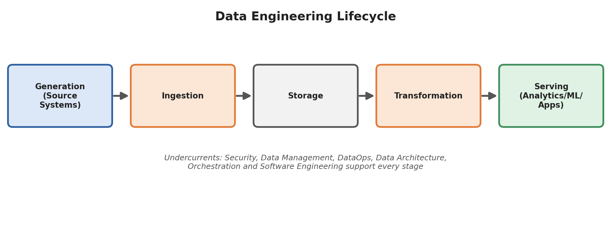

*Figure 1.1: The end-to-end Data Engineering Lifecycle showing sequential data flow from Generation to Serving, supported by cross-cutting undercurrents.*

---

### 3. Major Stages from Data Generation to Data Serving

The lifecycle describes every stage that data passes through from origin to business impact:

#### Stage 1: Generation (Source Systems)
Data is continuously created across diverse external and internal source applications. Data engineers do not typically control generation systems, but must integrate with them reliably:
* **Transactional Databases (OLTP):** PostgreSQL, MySQL, Oracle capturing operational business transactions.
* **Web and Mobile Client Applications:** User clicks, session logs, page views, search interactions, and cart updates.
* **IoT Sensors & Telemetry:** GPS tracking, temperature meters, smart grid devices, and hardware health logs.
* **Third-Party APIs & SaaS Platforms:** Payment gateways (Stripe, Razorpay), CRM tools (Salesforce), advertising feeds.

#### Stage 2: Ingestion
Ingestion is the process of collecting raw data from source systems and transporting it into the organization's data platform.
* **Batch Ingestion:** Data is extracted at scheduled intervals (hourly, nightly) in bounded chunks using tools like Apache Sqoop, Airbyte, or custom JDBC extracts.
* **Streaming Ingestion:** Events are ingested continuously in real time, record-by-record, using distributed message streaming platforms such as **Apache Kafka**, AWS Kinesis, or Google Cloud Pub/Sub.
* **Key Challenges:** Handling network failures, API rate limits, backpressure from slow consumers, schema changes, and avoiding duplicate ingestion.

#### Stage 3: Storage
Storage provides persistent, reliable, and accessible storage for raw, staging, and processed data.
* **Data Warehouses:** Centralized, structured, columnar repositories optimized for fast analytical SQL queries (e.g., Snowflake, Amazon Redshift, Google BigQuery).
* **Data Lakes:** Scalable distributed object stores holding raw, semi-structured, and unstructured data in open columnar formats like Parquet, ORC, Avro, and Delta Lake (e.g., Amazon S3, Azure ADLS Gen2, HDFS).
* **Key Decisions:** Partitioning schemas, compression codecs (Snappy, Zstandard), data lifecycle retention, and storage cost tiers (hot vs. cold storage).

#### Stage 4: Transformation
Transformation converts raw, untamed data into structured, clean, and modeled analytical datasets.
* **Data Cleansing:** Handling missing attributes, deduplication, correcting data types, and filtering corrupted records.
* **Business Logic & Modeling:** Creating Fact and Dimension tables, computing KPIs, aggregating metrics across rolling time windows, and joining disparate datasets.
* **Tools:** Apache Spark, dbt (data build tool), SQL engines, Trino/Presto.

#### Stage 5: Serving
The final stage where processed data delivers measurable business value to downstream consumers.
* **Business Intelligence (BI) & Analytics:** PowerBI, Tableau, Looker dashboards for operational reporting and executive KPIs.
* **Machine Learning & AI:** Feature stores (Feast) and feature pipelines feeding training models and inference engines.
* **Reverse ETL & Operational Analytics:** Writing transformed analytical metrics back into operational applications (e.g., updating customer health scores in Salesforce or Zendesk).
* **Operational Microservices:** Exposing processed analytical records to web and mobile apps via low-latency REST/gRPC APIs.

---

### 4. Cross-Cutting Undercurrents
Undercurrents are foundational practices that support and cut across every stage of the lifecycle:
1. **Security & Privacy:** End-to-end encryption (TLS in transit, AES-256 at rest), Role-Based Access Control (RBAC), masking Personally Identifiable Information (PII), and regulatory compliance (GDPR, CCPA, HIPAA).
2. **Data Management & Governance:** Data catalogs, automated data lineage tracking, metadata management, and data quality standards.
3. **DataOps & Observability:** Continuous Integration & Continuous Delivery (CI/CD) for data pipelines, automated testing, log aggregation, and latency alerting.
4. **Data Architecture:** Evaluating architectural tradeoffs: batch vs. streaming, centralized vs. decentralized (Data Mesh), and cloud vs. hybrid storage.
5. **Orchestration:** Managing workflow task dependencies, execution ordering, retries, and SLA monitoring (e.g., Apache Airflow, Dagster).
6. **Software Engineering:** Applying software engineering best practices: version control (Git), unit testing, modular coding, and idempotent pipeline execution.

### 5. Concrete Real-World Example: E-Commerce Ride / Order Tracking
Consider an online e-commerce platform during a flash sale:
* **Generation:** Millions of customers place orders on mobile apps; MySQL databases commit transactions.
* **Ingestion:** Kafka ingests clickstream and order events at 50,000 events/sec via Debezium CDC.
* **Storage:** Raw events land immediately in Amazon S3 (Data Lake) as snappy-compressed Parquet files.
* **Transformation:** Apache Spark and dbt models calculate regional hourly revenues, clean invalid addresses, and join order items with product catalogs.
* **Serving:** Tableau dashboards display live executive sales KPIs, while a fraud detection ML model evaluates chargeback risks in under 100 milliseconds.

---

## Question 2: Stages of ETL and ETL vs ELT

> **Question:**  
> Explain the three stages of ETL (Extract, Transform and Load). Also differentiate between ETL and ELT based on transformation location and suitable use cases.

### 1. The Three Stages of ETL
ETL (Extract, Transform, Load) is the foundational data integration pipeline pattern used to pull raw data from operational systems, transform it on a dedicated processing layer, and load it into a centralized analytical data warehouse.

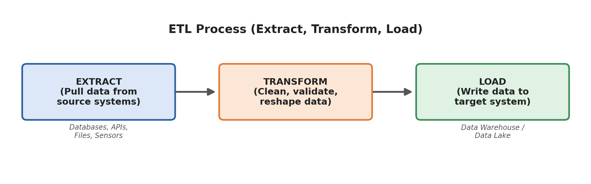

*Figure 2.1: Sequential stages of the traditional ETL pipeline.*

#### 1. Extract
* **Description:** Retrieves raw data from one or more heterogeneous source systems (relational databases, flat files, external REST APIs, sensor streams) without altering the source data.
* **Methods:**
  * *Full Extraction:* Pulling all records from the source each time (used for small lookup tables).
  * *Incremental Extraction:* Pulling only modified or new records since the last extraction using Change Data Capture (CDC), timestamps (`updated_at`), or log-based replication.
* **Objective:** Extract data quickly and non-intrusively to minimize operational impact on live production databases.

#### 2. Transform
* **Description:** The most compute-intensive stage where extracted data is cleansed, standardized, enriched, and structured into the target warehouse schema.
* **Key Operations:**
  * Cleansing corrupted values, imputing or removing nulls.
  * Removing duplicate rows and reconciling conflicting records.
  * Standardizing character encodings, timestamps (e.g., converting to UTC/ISO 8601), and measurement units.
  * Applying business calculations (e.g., discount logic, net profit).
  * Performing relational joins and dimensional lookups.

#### 3. Load
* **Description:** Writes the finalized, structured data into the destination target—typically a data warehouse, data mart, or operational data store.
* **Loading Strategies:**
  * *Initial Load:* Populating tables for the very first time.
  * *Append (Full Refresh vs Incremental):* Adding newly transformed records to existing tables.
  * *Upsert (Merge):* Updating existing records when primary keys match and inserting new records if keys are absent (Slowly Changing Dimensions - SCD).

---

### 2. Differentiating ETL and ELT
The fundamental distinction between ETL and ELT is **where and when the transformation takes place**:

* **ETL (Extract $\rightarrow$ Transform $\rightarrow$ Load):**  
  Data is extracted from sources, transformed on a dedicated middle-tier ETL server/engine (e.g., Informatica, Talend, SSIS), and only the finalized, modeled data is loaded into the warehouse. The target warehouse receives clean data only.
* **ELT (Extract $\rightarrow$ Load $\rightarrow$ Transform):**  
  Raw data is extracted and immediately loaded in its raw, unprocessed form into a cloud data warehouse or data lake. Transformations are executed directly inside the target data warehouse using its native massively parallel compute engine (SQL / dbt).

### 3. Comparison Table: ETL vs ELT

| Feature / Aspect | ETL (Extract - Transform - Load) | ELT (Extract - Load - Transform) |
| :--- | :--- | :--- |
| **Transformation Location** | **Before loading**, on a dedicated intermediate staging/ETL server. | **After loading**, directly inside the target cloud data warehouse/lake. |
| **Best Suited For** | On-premises systems, smaller datasets, rigid relational schemas, strict privacy rules requiring PII masking before storage. | Big Data, cloud data platforms, fast-changing schemas, unstructured/semi-structured data lakes. |
| **Speed of Ingestion / Loading** | **Slower:** Loading is blocked until computationally heavy transformations finish. | **Faster:** Raw data is immediately dumped into the target warehouse; transformation happens later. |
| **Compute & Storage Model** | Compute and storage are tightly coupled; heavy compute burden on the ETL staging server. | Decoupled cloud compute and storage; leverages elastic, massively parallel processing (MPP). |
| **Schema Paradigm** | **Schema-on-Write:** Schema must be strictly defined and validated before loading. | **Schema-on-Read / Hybrid:** Raw data is preserved, allowing developers to define/modify schemas later. |
| **Raw Data Availability** | Raw data is often discarded post-transformation to save disk space. | Raw historical data is permanently stored, allowing re-running transformations whenever logic changes. |
| **Common Tools** | Informatica PowerCenter, Microsoft SSIS, Talend Open Studio, IBM DataStage. | Snowflake, Google BigQuery, Amazon Redshift, Databricks, dbt (data build tool). |

### 4. Implementation Code Comparison

**ETL Paradigm (Python / PySpark Staging Script):**
```python
# Extract from Postgres
raw_df = spark.read.jdbc(url=pg_url, table="orders", properties=props)

# Transform in Memory on ETL Server
clean_df = raw_df.filter(raw_df.amount > 0) \
                 .withColumn("order_date", to_date(raw_df.timestamp)) \
                 .dropDuplicates(["order_id"])

# Load Cleaned Data into Target Warehouse
clean_df.write.mode("append").parquet("s3://warehouse/orders_clean/")
```

**ELT Paradigm (SQL / dbt inside Snowflake/BigQuery):**
```sql
-- Raw data already loaded directly into raw_orders table
-- Transform in-place using warehouse compute power
CREATE OR REPLACE TABLE analytics.fact_orders AS
SELECT 
    order_id,
    customer_id,
    DATE(order_timestamp) AS order_date,
    amount,
    amount * 0.18 AS estimated_tax
FROM raw_data.raw_orders
WHERE amount > 0;
```

---

## Question 3: ETL Architecture and Workflow

> **Question:**  
> Explain the ETL architecture and workflow with a neat diagram. Describe the role of the data sources, staging area, transformation engine, target data warehouse, and orchestration layer.

### 1. End-to-End ETL Architecture Diagram

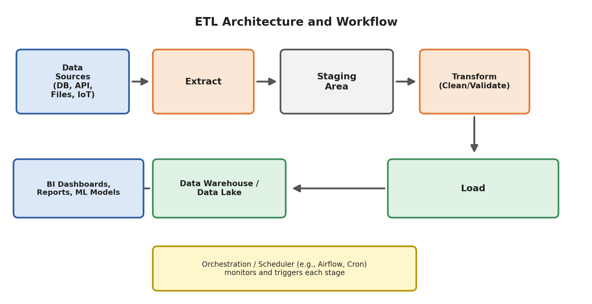

*Figure 3.1: Complete architecture and components of an end-to-end ETL system.*

---

### 2. Role of Architecture Components

#### 1. Data Sources
* The originating systems of record where enterprise data is created and updated.
* Consists of operational relational databases (MySQL, PostgreSQL, Oracle), external SaaS REST APIs, flat files (CSV, JSON, Parquet on SFTP/S3), application log streams, and IoT devices.
* Characterized by high heterogeneity in formats, rate limits, network protocols, and update schedules.

#### 2. Staging Area
* A temporary intermediate storage repository (staging database, disk directory, or S3 bucket) where raw extracted data lands before transformation.
* **Why the Staging Area is Critical:**
  * **Operational Isolation:** Isolates production databases from heavy, lock-inducing transformation queries.
  * **Pipeline Resilience:** If transformations fail midway, the pipeline can restart from the staging area without re-querying and overloading production sources.
  * **Asynchronous Decoupling:** Allows rapid, lightweight extraction jobs to run independently from longer-running transformation jobs.

#### 3. Transformation Engine
* The processing engine that applies cleaning algorithms, business rules, deduplication, joins, and aggregations.
* Can be a traditional ETL server (Talend, Informatica), a distributed cluster (Apache Spark, Hadoop), or in-warehouse SQL transformation jobs (dbt).
* Converts raw, unstructured/semi-structured records into normalized or dimensional star/snowflake tables.

#### 4. Target Data Warehouse / Data Lake
* The central analytical repository where query-ready data is permanently organized for analytical queries.
* Built on columnar storage engines (e.g., Snowflake, BigQuery, Amazon Redshift) designed for rapid scans and aggregations over millions or billions of rows.
* Often partitioned into departmental **Data Marts** (e.g., Finance, Sales, Customer Support) to optimize access control and performance.

#### 5. Orchestration Layer (Workflow Scheduler)
* The supervisory control system (e.g., **Apache Airflow**, Prefect, Dagster, Cron) that coordinates the end-to-end pipeline.
* **Responsibilities:**
  * **Dependency Management:** Enforces strict execution order via Directed Acyclic Graphs (DAGs) — ensuring transformation starts only after extraction finishes.
  * **Automated Scheduling:** Triggers pipeline runs at defined temporal intervals (e.g., nightly at 01:00 AM) or upon event triggers.
  * **Error Handling & Retries:** Automatically retries transient network failures with exponential backoff.
  * **Alerting & Auditing:** Emits alerts via Slack/Email upon failure and maintains logs for SLA tracking.

---

### 3. Concrete Example: Apache Airflow DAG Definition

```python
from airflow import DAG
from airflow.operators.python import PythonOperator
from datetime import datetime, timedelta

default_args = {
    'owner': 'data_engineer',
    'retries': 3,
    'retry_delay': timedelta(minutes=5),
}

with DAG(
    dag_id='daily_ecommerce_etl',
    default_args=default_args,
    start_date=datetime(2026, 1, 1),
    schedule_interval='@daily',
    catchup=False
) as dag:

    def extract_orders():
        print("Extracting records from MySQL to S3 Staging Area...")

    def transform_orders():
        print("Cleaning missing fields, joining with product catalogue...")

    def load_warehouse():
        print("Upserting transformed facts into Snowflake tables...")

    def notify_success():
        print("Alerting operations team: Pipeline finished successfully.")

    task_extract = PythonOperator(task_id='extract', python_callable=extract_orders)
    task_transform = PythonOperator(task_id='transform', python_callable=transform_orders)
    task_load = PythonOperator(task_id='load', python_callable=load_warehouse)
    task_notify = PythonOperator(task_id='notify', python_callable=notify_success)

    # Dependency Chain (DAG)
    task_extract >> task_transform >> task_load >> task_notify
```

---

## Question 4: OLTP vs OLAP Systems

> **Question:**  
> Differentiate between OLTP and OLAP systems with respect to purpose, type of data, query type, database design, and examples.

### 1. Conceptual Overview
* **OLTP (Online Transaction Processing):** Operational database systems optimized for real-time transaction processing. They handle large volumes of simple, concurrent reads and writes, emphasizing sub-second latency, atomicity, and high availability.
* **OLAP (Online Analytical Processing):** Analytical data warehouse systems optimized for reading, scanning, and summarizing massive volumes of historical data to uncover trends and guide strategic decisions.

### 2. Architecture & Data Flow Diagram

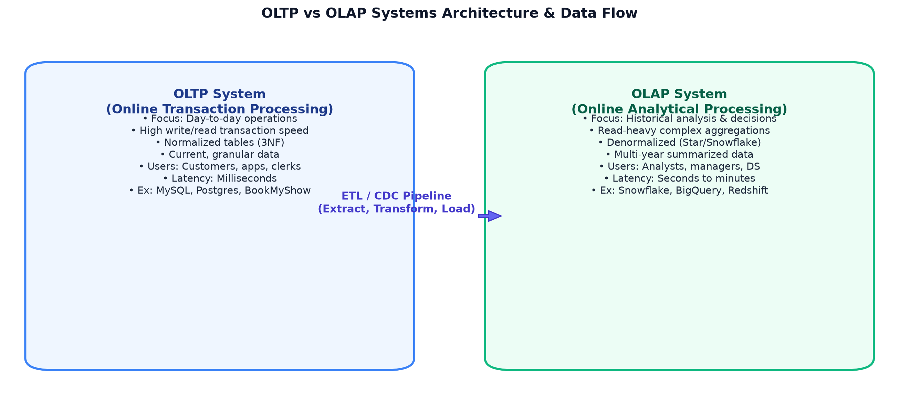

*Figure 4.1: Structural contrast between operational OLTP systems and analytical OLAP warehouses.*

---

### 3. Detailed Comparison Table

| Feature / Dimension | OLTP (Online Transaction Processing) | OLAP (Online Analytical Processing) |
| :--- | :--- | :--- |
| **Primary Purpose** | Manage and record day-to-day transactional business operations. | Analyze historical trends, aggregate metrics, and support business intelligence. |
| **Target Users** | Customers, clerks, operational employees, web/mobile applications. | Business analysts, data scientists, executives, management teams. |
| **Type of Data** | Current, up-to-the-second, granular, highly detailed records. | Multi-year historical, consolidated, aggregated, summarized records. |
| **Query Type** | Simple, fast lookups and atomic writes (`INSERT`, `UPDATE`, `DELETE`). | Complex, compute-intensive read queries with aggregations (`SUM`, `AVG`, `GROUP BY`). |
| **Database Design** | **Highly Normalized (3NF)** to minimize redundancy and maximize write speed. | **Denormalized (Star / Snowflake Schema)** to minimize joins and maximize read speed. |
| **Read vs Write Pattern** | High frequency of both reads and writes; balanced I/O. | Heavily read-dominated; writes occur in periodic scheduled batch loads. |
| **Response Latency** | Milliseconds ($< 50\text{ ms}$). | Seconds to minutes (depending on data volume and query complexity). |
| **Storage Architecture** | Row-oriented storage (efficient for accessing single whole rows). | Column-oriented storage (efficient for scanning selected columns over billions of rows). |
| **Data Scope & Volume** | Gigabytes of active, live data. | Terabytes to Petabytes of accumulated historical data. |
| **Hardware Focus** | High transaction throughput, write-ahead logging, fast disk write latency. | Massively Parallel Processing (MPP), distributed query execution, large memory/RAM. |
| **Real-World Examples** | Booking a movie ticket on BookMyShow, ATM cash withdrawal, e-commerce checkout. | Generating a 12-month regional sales trend report, calculating quarterly customer churn. |
| **Common Tools** | MySQL, PostgreSQL, Oracle DB, Microsoft SQL Server. | Snowflake, Amazon Redshift, Google BigQuery, ClickHouse. |

### 4. Query Comparison in SQL

**OLTP Query (Fast, Point-Update):**
```sql
-- Reserving seat 42B for show 501
UPDATE ticket_reservations 
SET status = 'CONFIRMED', updated_at = NOW() 
WHERE user_id = 9812 AND show_id = 501;
```

**OLAP Query (Broad Analytical Scan with Aggregation):**
```sql
-- Analyzing annual revenue per movie genre across western states
SELECT 
    m.genre, 
    d.year, 
    SUM(f.ticket_price) AS total_revenue,
    AVG(f.ticket_price) AS avg_ticket_price
FROM fact_ticket_sales f
JOIN dim_movie m ON f.movie_id = m.movie_id
JOIN dim_theater t ON f.theater_id = t.theater_id
JOIN dim_date d ON f.date_id = d.date_id
WHERE t.state IN ('Maharashtra', 'Gujarat', 'Goa')
GROUP BY m.genre, d.year
ORDER BY total_revenue DESC;
```

---

## Question 5: Star Schema vs Snowflake Schema

> **Question:**  
> Explain Star Schema and Snowflake Schema in data warehousing. Draw suitable diagrams and mention their key differences.

### 1. Facts vs. Dimensions
In data warehousing, analytical schemas organize relational tables into two primary types:
* **Fact Table:** The central table that stores quantitative, numerical measurements of a business event (e.g., `sales_amount`, `quantity_sold`, `tax_paid`). It also holds foreign keys pointing to dimension tables. Fact tables have a large number of rows and few columns.
* **Dimension Table:** Contextual tables containing descriptive textual attributes (e.g., customer details, product categories, calendar dates) that provide the "who, what, where, and when" context for fact measurements.

---

### 2. Star Schema

In a **Star Schema**, a central fact table connects directly to multiple denormalized dimension tables. The dimension tables are flat (not broken down into sub-tables), giving the schema a star-like structure.

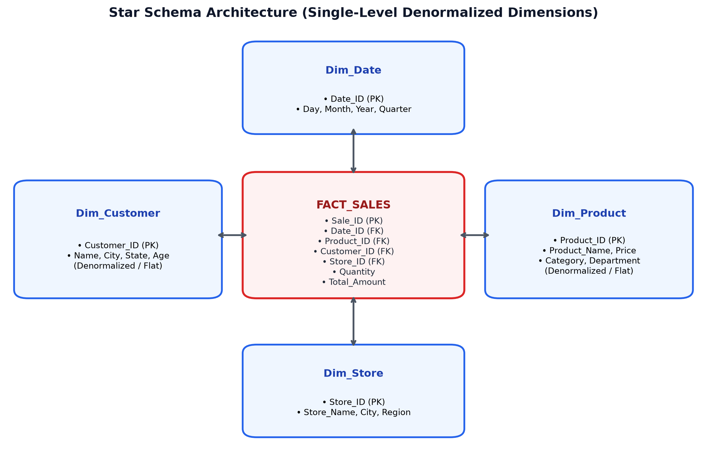

*Figure 5.1: Star Schema structure with a central Fact table and single-level, denormalized Dimension tables.*

* **Example Structure:**
  * `Fact_Sales`: `Sale_ID`, `Product_ID (FK)`, `Customer_ID (FK)`, `Date_ID (FK)`, `Store_ID (FK)`, `Quantity`, `Total_Amount`
  * `Dim_Product`: `Product_ID`, `Product_Name`, `Category`, `Department`, `Price` (Flat, denormalized).
  * `Dim_Customer`: `Customer_ID`, `Customer_Name`, `City`, `State`, `Country`, `Age`
* **Advantages:** Minimal joins required (only one join between fact and each dimension), resulting in very fast read queries and simple SQL syntax.
* **Disadvantages:** Contains data redundancy in dimension tables, which uses more storage and can complicate updates.

---

### 3. Snowflake Schema

A **Snowflake Schema** is an extension of the Star Schema where dimension tables are further normalized into multiple related sub-dimension tables. This splits hierarchical attributes into separate tables, creating a branched structure resembling a snowflake.

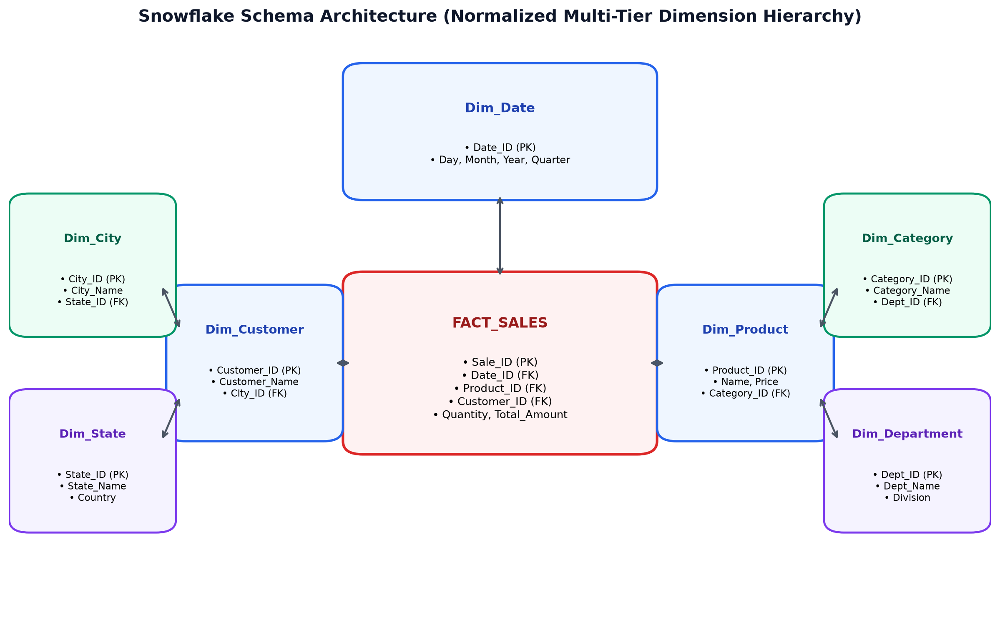

*Figure 5.2: Snowflake Schema structure with normalized, multi-tier dimension hierarchies.*

* **Example Hierarchy:**
  * `Fact_Sales` connects to `Dim_Product`.
  * `Dim_Product` holds `Category_ID (FK)` and connects to `Dim_Category`.
  * `Dim_Category` holds `Department_ID (FK)` and connects to `Dim_Department`.
* **Advantages:** Eliminates redundant data in dimension tables, reduces storage consumption, and maintains relational integrity.
* **Disadvantages:** Queries require multi-hop joins (e.g., `Fact_Sales` $\rightarrow$ `Dim_Product` $\rightarrow$ `Dim_Category` $\rightarrow$ `Dim_Department`), which can slow query execution and make SQL queries more complex.

---

### 4. Comparison Table: Star Schema vs Snowflake Schema

| Feature | Star Schema | Snowflake Schema |
| :--- | :--- | :--- |
| **Structure** | Central fact table surrounded by single-level, flat dimension tables. | Central fact table surrounded by multi-level, normalized dimension hierarchies. |
| **Normalization** | **Denormalized:** Dimensions intentionally retain duplicate attribute values. | **Normalized:** Dimensions are split into 2NF/3NF sub-tables to remove redundancy. |
| **Joins Needed** | **Fewer:** Every dimension is joined directly to the fact table with a single join. | **More:** Queries must join through multiple levels of sub-dimension hierarchies. |
| **Query Performance** | **Faster:** Simple joins allow database query planners to optimize table scans. | **Slightly Slower:** Multi-table joins increase CPU overhead and query execution time. |
| **Storage Overhead** | Consumes slightly more disk space due to repeated text values in dimensions. | Consumes less disk space because repeated values are normalized into lookups. |
| **Schema Maintenance** | Updates to an attribute require updating multiple rows in the dimension table. | Updates to an attribute require updating only a single row in the normalized lookup table. |
| **Ease of Use** | Simple and intuitive for business users and BI analysts to query. | More complex to navigate; requires understanding parent-child foreign key hierarchies. |
| **Best Suited For** | Fast analytical dashboards, data marts, and modern columnar cloud data warehouses. | Very large dimension datasets where storage optimization or strict normalization is required. |

### 5. Note on Slowly Changing Dimensions (SCD)
* **SCD Type 1 (Overwrite):** If a customer changes address, overwrite the old address. History is lost.
* **SCD Type 2 (Add New Row):** Add a new row with a new surrogate key, plus `valid_from`, `valid_to`, and `is_current = TRUE`. Complete historical tracking is preserved.

---

## Question 6: The N × M Integration Problem and Kafka Solution

> **Question:**  
> Explain how Apache Kafka solves the $N \times M$ integration problem in modern data systems. Compare the point-to-point integration model with the Kafka-based $N + M$ model and mention its key benefits.

### 1. The $N \times M$ Integration Problem
In point-to-point data architectures, every source system connects directly to every target application that requires its data. As organizations add new source services and analytical destinations, the number of point-to-point connections grows multiplicatively:

$$\text{Connections} = N \times M$$

where $N$ is the number of source applications and $M$ is the number of destination systems.

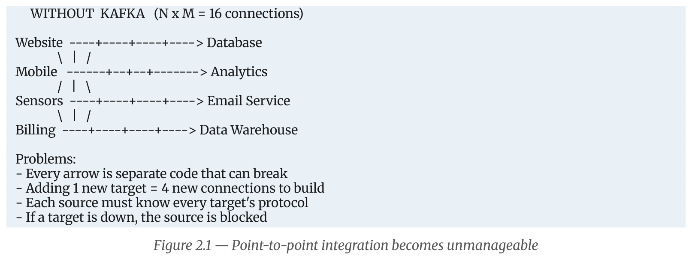

*Figure 6.1: The unmanageable spaghetti architecture of point-to-point connections ($N \times M = 16$).*

#### Drawbacks of the Point-to-Point Model:
1. **Exponential Connection Growth:** 4 sources and 4 destinations require 16 custom integrations. 10 sources and 10 destinations require 100 pipelines. 20 sources and 20 destinations require 400 separate connections.
2. **Coupling Bottlenecks:**
   * **Availability Coupling:** If a destination system experiences downtime, the upstream source is either blocked or must buffer records in memory, risking crashes.
   * **Speed Coupling:** Fast sources are slowed down by slow targets.
   * **Protocol & Format Coupling:** Sources must format data specifically for each target (JSON, XML, JDBC, REST, custom binary).
3. **High Maintenance Overhead:** Each connection is a separate integration pipeline with its own error handling, monitoring, and failure modes. Adding one new destination requires changes across all $N$ source systems.

---

### 2. The Kafka Solution: The $N + M$ Model
Apache Kafka replaces this point-to-point mesh with a **centralized, distributed event-streaming backbone**.
* Every source system writes its events **once** to Kafka.
* Every target system reads independently from Kafka at its own pace.
* The number of connections scales linearly:

$$\text{Connections} = N + M$$

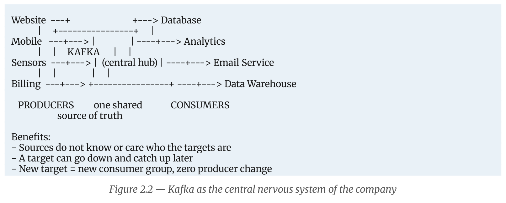

*Figure 6.2: Kafka acting as the central nervous system, reducing complexity from $N \times M$ to $N + M$.*

---

### 3. Tight vs. Loose Coupling

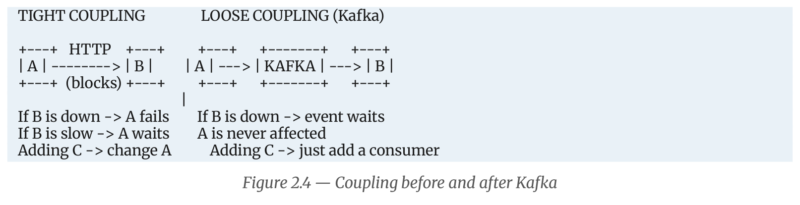

*Figure 6.3: Architectural decoupling achieved by introducing Kafka between services.*

---

### 4. Comparison: Point-to-Point vs Kafka $N + M$ Model

| Metric / Aspect | Point-to-Point Integration ($N \times M$) | Kafka Event Streaming ($N + M$) |
| :--- | :--- | :--- |
| **Number of Connections** | Exponential growth: $N \times M$ pipelines. | Linear growth: $N + M$ pipelines. |
| **Adding a New Target** | Requires building $N$ new connections from every source. | Requires adding 1 consumer connection to Kafka; **zero source code changes**. |
| **Coupling Level** | Tightly coupled in availability, speed, and data format. | Fully decoupled; systems interact only through Kafka topics. |
| **Impact of Target Downtime** | Sources fail, block, or drop data. | Events safely accumulate on Kafka's disk log; the target catches up when it recovers. |
| **Data Replayability** | Not supported; messages cannot be re-sent without manual work. | Fully supported; consumers can reset their offset and reprocess past events. |

### 5. Historical Context: LinkedIn's Need for Kafka
In 2010, LinkedIn operated dozens of point-to-point systems connecting web apps to ActiveMQ, Oracle, Search (Lucene), and Hadoop. Each queue collapsed under high event throughput. Jay Kreps, Neha Narkhede, and Jun Rao created Apache Kafka to act as a unified, high-throughput append-only distributed log, enabling millions of user-activity messages per second.

---

## Question 7: Data Cleaning and Data Transformation Processes

> **Question:**  
> Explain the Data Cleaning and Data Transformation processes. Discuss different techniques used for handling missing values, duplicates, inconsistent formats, outliers, normalization, aggregation, and joining data.

### 1. Conceptual Breakdown
* **Data Cleaning:** The process of detecting, correcting, or removing inaccurate, incomplete, duplicate, corrupted, or irrelevant records from raw datasets. It focuses on **data quality and correctness**.
* **Data Transformation:** The process of reshaping, restructuring, and converting cleaned data into standardized formats required for target schemas, analytical queries, and machine learning models. It focuses on **structural consistency and business logic**.

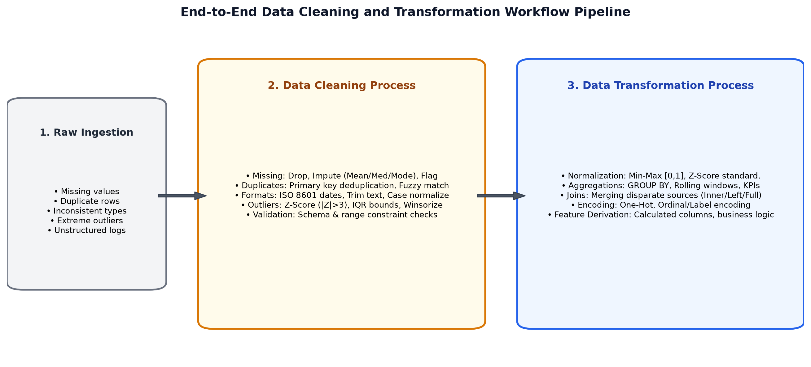

*Figure 7.1: Pipeline flow from raw ingestion through cleaning and transformation stages.*

---

### 2. Data Cleaning Techniques

#### 1. Handling Missing Values (Nulls)
* **Dropping / Deletion:**
  * *Row Deletion (Listwise):* Dropping records that have missing values in critical identifier columns (e.g., `user_id`, `transaction_id`).
  * *Column Deletion:* Dropping entire columns where missingness exceeds a high threshold (e.g., $>60\%$ missing values).
* **Imputation:**
  * *Mean Imputation:* Filling missing values with the arithmetic mean (best for symmetric, normally distributed numerical data).
  * *Median Imputation:* Filling with the median (preferred for skewed numerical distributions with outliers, such as income or house prices).
  * *Mode Imputation:* Filling with the most frequent value (used for categorical fields like `City` or `Country`).
  * *Forward Fill (ffill) / Backward Fill (bfill):* Propagating the previous or subsequent valid observation (standard in financial and time-series data).
* **Flagging:** Creating an explicit boolean indicator column (e.g., `is_income_missing = 1`) and filling the missing field with a default value, preserving the missingness signal for machine learning algorithms.

```python
# Python Implementation of Imputation
df['income_imputed'] = df['income'].fillna(df['income'].median())
df['is_income_missing'] = df['income'].isnull().astype(int)
df['city'] = df['city'].fillna('Unknown')
```

#### 2. Handling Duplicate Records
* **Exact Duplicate Removal:** Identifying and removing rows that are identical across every column using operations like `DROP DUPLICATES` or `SELECT DISTINCT`.
* **Key-Based Deduplication:** Records sharing the same primary key but differing in timestamps. Handled by ordering by timestamp descending and keeping only the latest record:
  ```sql
  SELECT * FROM (
      SELECT *, ROW_NUMBER() OVER (PARTITION BY order_id ORDER BY event_time DESC) as rn
      FROM orders_staging
  ) WHERE rn = 1;
  ```
* **Fuzzy Deduplication:** Matching non-identical text representations of the same entity (e.g., "Soham K." vs. "Soham Kotkar") using string distance metrics like Levenshtein distance or Jaro-Winkler.

#### 3. Handling Inconsistent Formats
* **Date & Time Standardization:** Parsing varying date inputs (`DD/MM/YYYY`, `MM-DD-YYYY`, Unix epoch timestamps) and converting them into a single standard **ISO 8601** format (`YYYY-MM-DDTHH:MM:SSZ`).
* **Text Normalization:** Stripping leading/trailing whitespace, removing non-printable control characters, and standardizing casing (`UPPER`, `lower`, or `Title Case`).
* **Categorical Value Harmonization:** Mapping diverse synonyms to a canonical value (e.g., `"M"`, `"Male"`, `"male"`, `"MALE"` $\rightarrow$ `"Male"`).
* **Unit Standardization:** Converting mixed units of measurement (e.g., pounds to kilograms, Fahrenheit to Celsius, currency conversions to base USD).

#### 4. Outlier Detection and Treatment
* **Statistical Detection:**
  * *Z-Score Method:* Measures distance from the mean in standard deviation units ($Z = \frac{X - \mu}{\sigma}$). Values with $|Z| > 3$ are flagged as outliers.
  * *Interquartile Range (IQR) Method:* Uses the 25th ($Q_1$) and 75th ($Q_3$) percentiles ($IQR = Q_3 - Q_1$). Outliers are values outside $[Q_1 - 1.5 \times IQR, Q_3 + 1.5 \times IQR]$.
* **Treatment Methods:**
  * *Trimming:* Removing outlier rows if they represent sensor errors or invalid test records.
  * *Winsorizing (Capping):* Replacing extreme outliers with the 1st or 99th percentile boundary values.
  * *Log Transformation:* Applying $\log(x)$ or power transforms to compress wide ranges in skewed data.

---

### 3. Data Transformation Techniques

#### 1. Normalization and Standardization
* **Min-Max Normalization:** Rescales feature values to a fixed range, typically $[0, 1]$:
  $$X_{\text{norm}} = \frac{X - X_{\text{min}}}{X_{\text{max}} - X_{\text{min}}}$$
* **Z-Score Standardization:** Shifts and scales data to have a mean ($\mu$) of $0$ and standard deviation ($\sigma$) of $1$:
  $$Z = \frac{X - \mu}{\sigma}$$

#### 2. Aggregation
* Summarizes fine-grained transactional events into broader business metrics using `GROUP BY`:
  * Calculating sums, averages, counts, minimums, and maximums across grouping dimensions.
  * Computing rolling time-window aggregates (e.g., 7-day moving averages).

#### 3. Joining Data
* Merging disparate datasets based on shared relational keys:
  * **Inner Join:** Retains only rows with matching keys in both datasets.
  * **Left Outer Join:** Retains all rows from the primary dataset, filling missing values from the joined dataset with NULLs.
  * **Full Outer Join:** Retains all rows from both datasets.

#### 4. Categorical Encoding
* **One-Hot Encoding:** Creates separate binary columns for each unique category (ideal for non-ordered categories like `Payment_Mode: [UPI, Card, Cash]`).
* **Ordinal / Label Encoding:** Maps categories with inherent order to sequential numbers (e.g., `Priority: [Low=1, Medium=2, High=3]`).

---

## Question 8: Batch Processing vs Real-Time Processing

> **Question:**  
> Explain Batch Processing and Real-Time Processing. Compare them based on data handling, latency, use cases, common tools, and resource requirements.

### 1. Conceptual Definitions
* **Batch Processing:** A data processing paradigm where incoming data is accumulated over a period of time, stored in bounded chunks (batches), and then processed together on a schedule (e.g., hourly, nightly).
* **Real-Time (Stream) Processing:** A paradigm where unbounded data is ingested and processed continuously, record-by-record or in micro-batches, within milliseconds of each event occurring.

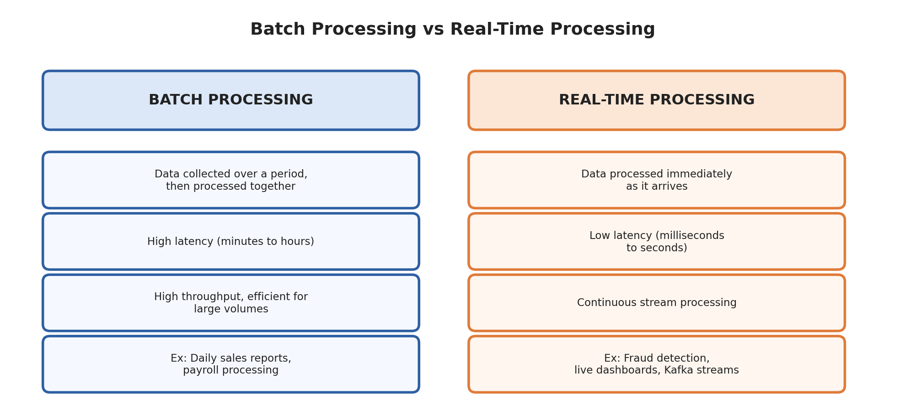

*Figure 8.1: Conceptual comparison of Batch Processing vs Real-Time Stream Processing.*

---

### 2. Comprehensive Comparison Table

| Feature / Dimension | Batch Processing | Real-Time (Stream) Processing |
| :--- | :--- | :--- |
| **Data Handling** | Processed in large, fixed-size, bounded chunks/batches. | Processed continuously as an unbounded stream, record-by-record. |
| **Latency** | **High:** Minutes, hours, or overnight batch delays. | **Ultra-Low:** Milliseconds to seconds. |
| **Data Scope** | Bounded: All dataset records are available before processing starts. | Unbounded: Data arrives indefinitely; results update continuously. |
| **Use Cases** | Payroll generation, end-of-day banking reconciliation, monthly billing, model re-training. | Credit card fraud detection, live system health monitoring, GPS tracking, real-time push alerts. |
| **Common Tools** | Apache Sqoop, Apache Hadoop MapReduce, Apache Spark (Batch), traditional ETL tools. | Apache Kafka, Apache Flink, Apache Spark Streaming, Apache Samza. |
| **Resource Usage** | **Bursty & Scheduled:** Compute clusters spin up on schedule, run at full utilization, and shut down. | **Continuous / Always-On:** Requires dedicated 24/7 cluster infrastructure to process events as they arrive. |
| **Throughput** | High overall throughput when processing large historical datasets. | High throughput per event; scales horizontally via partition distribution. |
| **Error Recovery** | **Simple:** Re-run the entire batch job from the beginning upon failure. | **Complex:** Requires distributed checkpointing, state recovery, and offset tracking. |

---

### 3. Case Study: Fraud Detection Latency

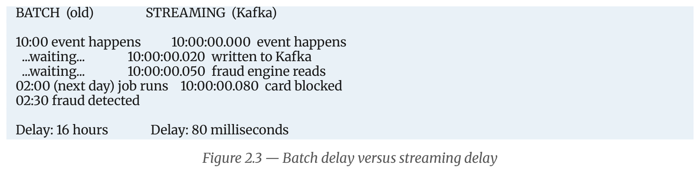

*Figure 8.2: Timeline comparison showing why real-time streaming is essential for fraud prevention.*

* **Batch Scenario (Legacy):**
  * A stolen credit card is used at 10:00 AM.
  * The system batches transactions throughout the day.
  * The nightly batch job runs at 02:00 AM the next day.
  * Fraud is detected at 02:30 AM — **16 hours and 20 unauthorized purchases too late**.
* **Streaming Scenario (Kafka + Flink):**
  * A stolen credit card is used at 10:00:00.000 AM.
  * Event published to Kafka at 10:00:00.020 AM (20 ms).
  * The fraud engine consumes and evaluates rules at 10:00:00.050 AM (50 ms).
  * The card is blocked at 10:00:00.080 AM (**total delay: 80 milliseconds**). The second fraudulent transaction is prevented.

### 4. Lambda vs. Kappa Architecture
* **Lambda Architecture:** Combines two parallel processing layers: a Batch Layer (comprehensive historical accuracy) and a Speed Layer (low-latency streaming). Downstream queries merge results from both. *Drawback:* Requires maintaining two separate codebases.
* **Kappa Architecture:** Eliminates the dual codebase. Everything is treated as a continuous stream using Apache Kafka and Apache Flink. Historical re-computations are simply re-streamed from Kafka's log.

---

## Question 9: The Notebook Model of Apache Kafka

> **Question:**  
> Explain the notebook model of Apache Kafka. Describe the roles of producers, consumers, partitions, offsets, replicas, and retention.

### 1. The Library Notebook Analogy
To understand Apache Kafka's architecture, consider the analogy of a **long physical notebook kept on a library desk**:

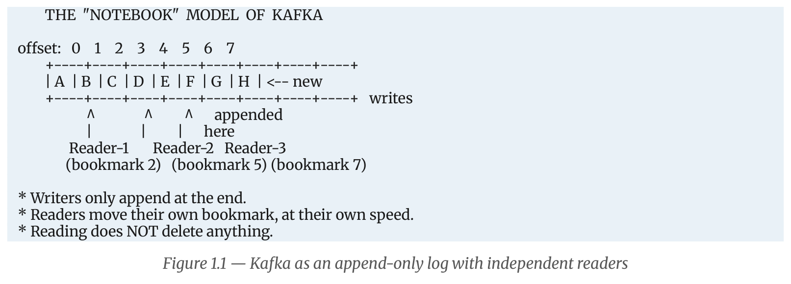

*Figure 9.1: Kafka as an append-only log with independent readers maintaining bookmarks.*

#### The Rules of the Notebook:
1. **Append-Only:** Anyone can write a new line, but strictly at the end of the notebook. Text already written can never be edited or erased.
2. **Sequential Line Numbers:** Every new line automatically receives an incremental number ($0, 1, 2, 3, \dots$).
3. **Independent Readers:** Many readers can read the notebook simultaneously. Each reader keeps their own bookmark showing where they have reached.
4. **Non-Destructive Reads:** Reading a line does not erase it. Ten different readers can read line 57 independently at their own pace.
5. **Photocopies for Redundancy:** The library makes exact photocopies of the notebook and stores them in separate rooms. If one room catches fire, no notes are lost.
6. **Retention:** Very old pages are discarded after a set number of days (e.g., 7 days) to conserve physical space.

---

### 2. Mapping the Notebook Analogy to Kafka Architecture

| Notebook Concept | Kafka Concept | Architectural Definition |
| :--- | :--- | :--- |
| **The Notebook** | **Partition** | The physical, append-only log file stored on broker disk. |
| **Line Number** | **Offset** | Sequential 64-bit integer identifying each record in a partition. |
| **Writers** | **Producers** | Applications that publish and append records to Kafka topics. |
| **Readers** | **Consumers** | Applications that pull and read records from partitions. |
| **Bookmark** | **Committed Offset** | The consumer's saved progress point stored in `__consumer_offsets`. |
| **Photocopies** | **Replicas** | Redundant copies of a partition stored on other brokers. |
| **Discarding Old Pages** | **Retention Policy** | Scheduled background cleanup deleting data older than `retention.ms` or larger than `retention.bytes`. |

---

### 3. Detailed Role Descriptions

1. **Producers:** Client applications that write records into Kafka topics. The producer determines which partition receives each record using key-based hashing or a sticky partitioner, batches records into memory buffers, and sends them asynchronously to the partition leader.
2. **Consumers:** Client applications that read records from topics using an explicit pull model. Consumers track their progress by periodically committing their offsets to Kafka, allowing them to resume seamlessly if they crash and restart.
3. **Partitions:** The fundamental unit of scalability, storage, and parallelism in Kafka. Topics are split into multiple partitions distributed across cluster brokers. Each partition is an ordered, immutable, append-only commit log.
4. **Offsets:** Unique, monotonically increasing integers assigned by the broker to records within a partition. Offsets start at 0 and are never reused or altered. The combination of `(Topic, Partition, Offset)` uniquely identifies any record in the cluster.
5. **Replicas:** Duplicate copies of a partition maintained across different physical brokers to guarantee high availability and fault tolerance. One replica is elected **Leader** (serves all client reads and writes), while the remaining replicas are **Followers** (replicate data from the leader). Followers that are fully caught up form the **In-Sync Replicas (ISR)**.
6. **Retention:** The policy that controls how long records remain on disk before deletion. Unlike traditional message queues that delete messages immediately upon consumption, Kafka retains records independently of whether they have been read. Records are purged only when they exceed time limits (`log.retention.hours = 168`) or size limits (`log.retention.bytes`).

### 4. Physical Storage: Partition Segments on Disk

```
/kafka-logs/orders-0/
│── 00000000000000000000.log        <- Segment file storing actual binary records
│── 00000000000000000000.index      <- Index mapping offset -> byte position in .log
│── 00000000000000000000.timeindex  <- Index mapping timestamp -> offset
│── 00000000000000123456.log        <- Active segment receiving current writes
└── leader-epoch-checkpoint
```
* **Active Segment:** Only the most recent segment receives writes.
* **Index Files:** Allow Kafka to jump to any offset or timestamp in $O(1)$ memory lookup without scanning the log file from the beginning.

---

## Question 10: Kafka Event / Record Structure

> **Question:**  
> What is a Kafka event/record? Explain the important components of a Kafka record, including key, value, timestamp, headers, partition, and offset.

### 1. Definition of a Kafka Event / Record
An **event** (also called a **record** or **message**) is the fundamental, atomic unit of data in Apache Kafka. It represents an immutable statement of fact—a record that an action occurred in the past (e.g., `OrderPlaced`, `UserRegistered`, `PaymentFailed`). Because past events cannot be changed, Kafka records are append-only and cannot be modified once written.

### 2. Diagram of a Kafka Record

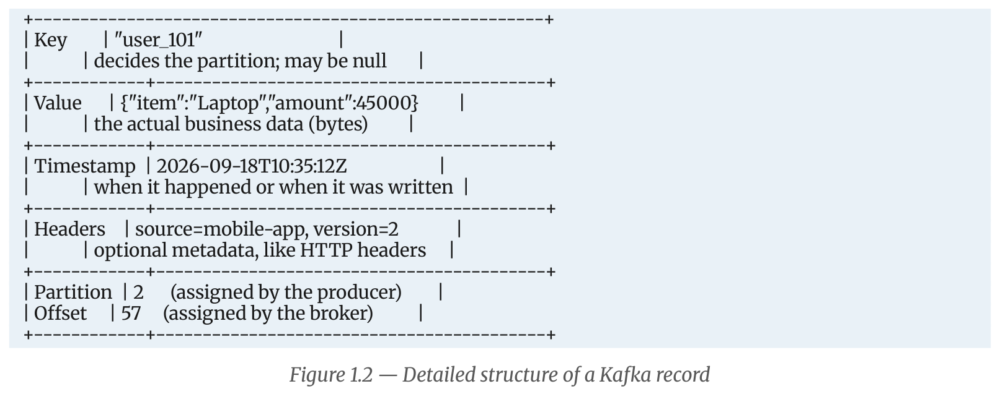

*Figure 10.1: Internal fields and layout of an individual Kafka record.*

---

### 3. Detailed Component Explanations

#### 1. Key
* **Type:** String, integer, UUID, composite object, or `null`. Stored as a raw byte array.
* **Role & Behavior:**
  * **Partition Assignment:** If a key is present, the producer hashes it to determine the target partition:
    $$\text{Partition} = \text{hash}(\text{key}) \pmod{\text{Total Partitions}}$$
    This guarantees that all records with the same key (e.g., all events for `user_101`) land in the **same partition**, ensuring strict chronological order for that entity.
  * **Log Compaction:** In compacted topics, Kafka retains only the latest record for each key.
  * **Null Keys:** If the key is null, Kafka's sticky partitioner distributes records across partitions in batches to optimize throughput.

#### 2. Value
* **Type:** Opaque byte array (`byte[]`).
* **Role & Behavior:** The actual business payload being transferred (e.g., a serialized JSON object, Apache Avro binary, Protocol Buffers binary, or plain text). The Kafka broker does not inspect or parse the value; it treats it as a raw sequence of bytes.

#### 3. Timestamp
* **Type:** 64-bit integer representing Unix epoch time in milliseconds.
* **Modes:**
  * `CreateTime`: Set by the producer application when the record is created.
  * `LogAppendTime`: Overwritten by the broker when it appends the record to disk.
* **Role & Behavior:** Used for time-based log retention cleanup, time-indexed search lookups (`.timeindex`), and windowed stream operations in Kafka Streams and Flink.

#### 4. Headers
* **Type:** Optional list of key-value pairs (strings to byte arrays), introduced in Kafka 0.11.
* **Role & Behavior:** Carries transport metadata without modifying the core business payload schema. Common examples include:
  * Distributed tracing IDs (OpenTelemetry, Zipkin trace headers).
  * Data origin source tags and schema version IDs.
  * Routing instructions and authorization tokens.

#### 5. Partition
* **Type:** 0-indexed integer.
* **Role & Behavior:** Indicates the specific partition within the topic where the record is stored. Assigned on the client side by the producer's partitioner logic prior to transmission.

#### 6. Offset
* **Type:** 64-bit sequential, monotonically increasing integer ($0, 1, 2, \dots$).
* **Role & Behavior:** Assigned strictly by the broker when writing the message to the partition segment on disk. Offsets are immutable and uniquely locate a record within its partition.

---

### 4. Serialization: JSON vs Apache Avro vs Protobuf

```
SIZE COMPARISON OF THE SAME RECORD
JSON:    {"orderId":"A1","customer":"user_101","item":"Laptop","amount":45000.0}   -> ~78 bytes
Avro:    [magic][schemaID][A1|user_101|Laptop|45000]                                 -> ~28 bytes (-64%)
Protobuf:[magic][schemaID][1:A1][2:user_101]...                                      -> ~26 bytes (-67%)
```

* **Schema Registry Wire Format:**
  * Byte 0: Magic Byte (`0x00`)
  * Bytes 1–4: 4-byte Schema ID registered in Schema Registry
  * Bytes 5+: Pure binary data (no repetitive field names).

---

## Question 11: Apache Kafka Architecture

> **Question:**  
> Explain the Kafka architecture with a suitable diagram. Describe the roles of Kafka brokers, topics, partitions, producers, and consumers.

### 1. Complete Architecture Diagram

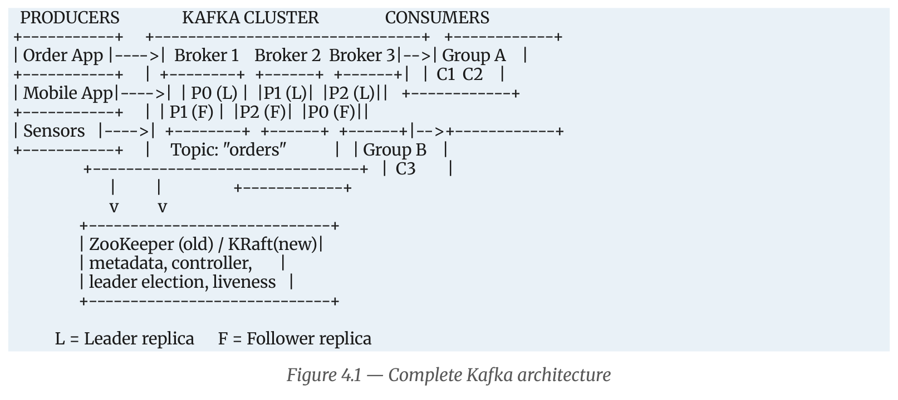

*Figure 11.1: Complete architecture of Apache Kafka showing Producers, Brokers, Partitions, and Consumer Groups.*

---

### 2. Partitions and Replicas Across Brokers

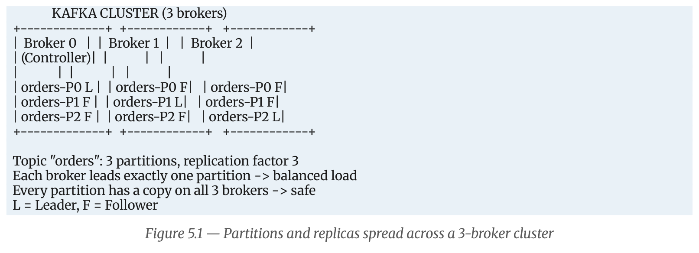

*Figure 11.2: Distribution of partition leaders and followers across a 3-broker cluster.*

---

### 3. In-Depth Component Explanations

#### 1. Kafka Brokers
* A broker is a single Kafka server process running on a host machine. A collection of brokers forms a Kafka cluster.
* **Responsibilities:**
  * **Log Storage:** Appends records to disk in partition segment files (`.log`, `.index`, `.timeindex`).
  * **Stateless Client Serving:** Serves fetch requests to consumers and write requests from producers without tracking consumer read state.
  * **Replication:** Participates in partition replication as either a Leader or Follower.
  * **Bootstrap Metadata:** Any single broker acts as a bootstrap server, providing connecting clients with complete cluster metadata (broker list, topic partitions, leaders).

#### 2. Topics
* A logical stream or category to which records are published (analogous to a table in a database or a directory in a filesystem).
* Named using domain conventions (e.g., `shop.order.created`).
* Multiple independent producers can write to the same topic, and multiple independent consumer groups can read from it concurrently.

#### 3. Partitions
* The physical realization of a topic on broker disk. A topic is split into one or more partitions.
* **Key Functions:**
  * **Horizontal Scalability:** Spreads topic data across multiple physical machines and disk drives.
  * **Parallelism:** The unit of consumer parallelism. Each partition can be consumed by at most one consumer in a consumer group at any given time.
  * **Ordering Guarantee:** Kafka guarantees strict FIFO message ordering **only within a single partition**, never across different partitions of a topic.

#### 4. Producers
* Client applications that write records into Kafka topics.
* **Internal Pipeline:**
  1. Serializes key and value objects into byte arrays.
  2. Partitioner selects target partition (via key hash or sticky batching).
  3. Accumulates records in memory buffers (`RecordAccumulator`).
  4. Compresses batches (Snappy, LZ4, Gstandard) and transmits them to partition leader brokers asynchronously.

#### 5. Consumers
* Client applications that read records from Kafka topics using a pull model (`poll()`).
* Fetch records in batches, process business logic, and commit read progress offsets to the internal `__consumer_offsets` topic.

#### 6. Coordination Layer: Controller, ZooKeeper, and KRaft
* **The Controller Broker:** One broker in the cluster is elected as Controller. It monitors broker heartbeats, detects node failures, and elects new partition leaders from the ISR.
* **ZooKeeper (Legacy):** External ensemble previously used for cluster metadata and leader election. Deprecated in Kafka 3.x and removed in Kafka 4.0.
* **KRaft (Modern Kafka Raft):** Built-in event-driven Raft consensus algorithm where selected brokers manage metadata in an internal `@metadata` topic, removing external dependencies.

---

### 4. Six Reasons Why Kafka is Extremely Fast

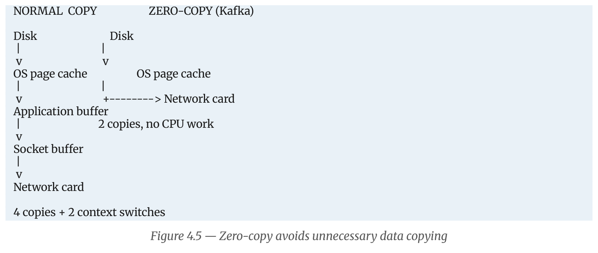

*Figure 11.3: Zero-copy transfer using the sendfile() OS system call bypassing application buffers.*

1. **Sequential Disk I/O:** Kafka only appends to disk. Sequential disk access reaches speeds of several hundred megabytes per second, rivaling random memory access.
2. **Zero-Copy Network Transfer:** Using the `sendfile()` Linux kernel system call, data goes straight from OS page cache into the network socket buffer without copying into JVM heap space.
3. **OS Page Cache:** Kafka relies directly on the operating system kernel cache rather than maintaining a large Java heap cache, avoiding garbage collection pauses.
4. **Batching:** Producers and consumers group messages into large batches, maximizing network TCP efficiency.
5. **End-to-End Compression:** Batches are compressed (Snappy, LZ4) on the producer and remain compressed in the broker until unpacked by the consumer.
6. **Partition-Level Parallelism:** Multiple brokers and disks serve reads and writes concurrently.

---

## Question 12: Kafka Consumer Groups and Parallel Processing

> **Question:**  
> What are Kafka Consumer Groups? Explain how consumer groups help in parallel processing and how partitions are assigned among consumers.

### 1. What is a Consumer Group?
A **Consumer Group** is a set of consumer instances sharing the same `group.id` that cooperate to consume records from a topic.
* Kafka divides the partitions of the subscribed topic among the members of the group, so each member processes a distinct subset of the data.
* It combines two traditional messaging patterns:
  1. **Queueing (Load Balancing):** Within a single group, each message is processed by only one consumer. Adding consumers increases processing capacity.
  2. **Publish-Subscribe (Fan-out):** Multiple consumer groups can subscribe to the same topic. Each group receives its own independent copy of every message.

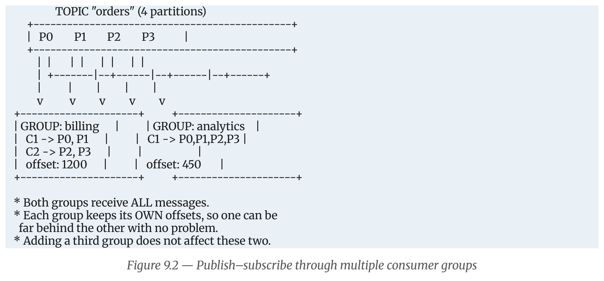

*Figure 12.1: Two independent consumer groups (Billing and Analytics) reading the same topic with separate offsets.*

---

### 2. How Consumer Groups Enable Parallel Processing
* Kafka achieves parallel processing on the consumer side by assigning different partitions of a topic to different consumers in the group.
* Consumers process records from their assigned partitions concurrently on separate threads, processes, or physical machines.
* Because partitions are isolated, read operations run concurrently without locking or coordination overhead between consumers.

---

### 3. The Five Golden Rules of Consumer Groups

```
Rule 1: Within a group, each partition is assigned to EXACTLY ONE consumer.
Rule 2: A single consumer CAN read multiple partitions.
Rule 3: If Consumers > Partitions, excess consumers remain completely IDLE.
Rule 4: The maximum useful parallelism of a group EQUALS the number of partitions.
Rule 5: Different consumer groups are 100% independent with separate offsets.
```

---

### 4. Partition Assignment Sizing Scenarios

Consider a topic `orders` with **4 Partitions (P0, P1, P2, P3)**:

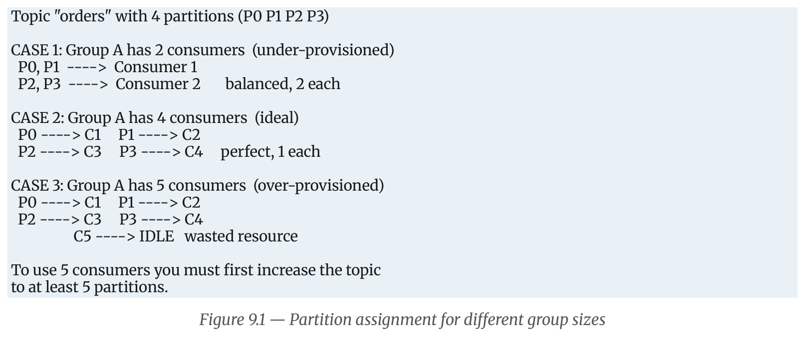

*Figure 12.2: Partition assignment across Under-provisioned, Ideal, and Over-provisioned consumer groups.*

* **Case 1: Under-Provisioned (2 Consumers):**  
  Partitions P0 and P1 $\rightarrow$ Consumer 1; P2 and P3 $\rightarrow$ Consumer 2. Each consumer handles 2 partitions.
* **Case 2: Ideal (4 Consumers):**  
  Each consumer is assigned exactly 1 partition. Achieves optimal parallelism and throughput.
* **Case 3: Over-Provisioned (5 Consumers):**  
  Consumers 1 through 4 each get 1 partition. **Consumer 5 remains idle** because no unassigned partitions remain. To scale further, the topic's partition count must be increased.

---

### 5. Partition Assignment Strategies
The Group Leader consumer runs an assignment strategy to determine how partitions are distributed:
1. **RangeAssignor:** Assigns contiguous ranges of partitions on a per-topic basis. Can cause uneven partition distribution when consuming multiple topics.
2. **RoundRobinAssignor:** Distributes all partitions from all subscribed topics evenly in round-robin fashion across consumers.
3. **StickyAssignor:** Balances partitions evenly while minimizing partition reassignments during rebalances.
4. **CooperativeStickyAssignor (Modern Best Practice):** Uses **Cooperative Incremental Rebalancing**. Instead of stopping all consumers ("stop-the-world" eager rebalance), only the specific partitions being moved are revoked, allowing unaffected consumers to continue processing.

---

### 6. Consumer Lag

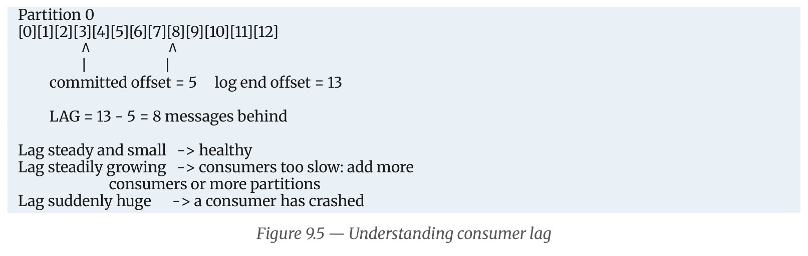

*Figure 12.3: Consumer Lag defined as the gap between Log End Offset and Committed Offset.*

* **Formula:**
  $$\text{Consumer Lag} = \text{Log End Offset} - \text{Committed Offset}$$
* **Operational Meaning:** Consumer lag indicates the number of messages written by producers that have not yet been processed by the consumer group.
  * *Lag steady and small:* Consumer group is healthy and keeping up with producer traffic.
  * *Lag steadily increasing:* Consumers are too slow; more consumers or partitions are needed.
  * *Lag spikes suddenly:* Indicates a consumer crash or processing bottleneck.

### 7. Worked Scaling Problem
* **Scenario:** A topic receives **6,000 messages/sec** across **6 partitions**. Each consumer can process **1,500 messages/sec**.
* **Analysis:**
  * 1 Consumer: $1 \times 1500 = 1500\text{ msg/s}$ (Lag increases by 4500 msg/s).
  * 2 Consumers: $2 \times 1500 = 3000\text{ msg/s}$ (Lag still grows).
  * 4 Consumers: $4 \times 1500 = 6000\text{ msg/s}$ (Keeps up exactly, but no headroom).
  * **6 Consumers:** $6 \times 1500 = 9000\text{ msg/s}$ (Ideal: 1 consumer per partition, 50% traffic spike headroom).
  * 8 Consumers: $6 \times 1500 = 9000\text{ msg/s}$ (No improvement; 2 consumers sit completely idle).

---

## Question 13: Kafka Single-Node Setup and Basic Operations

> **Question:**  
> Explain the steps involved in setting up a single-node, single-broker Kafka cluster. Also describe the basic operations for creating a topic and producing and consuming messages.

### 1. Objective and Prerequisites
* **Objective:** Install, configure, and run a single-broker Apache Kafka cluster on a single machine for development and testing.
* **Prerequisites:**
  * Operating System: Linux, macOS, or Windows.
  * Java Development Kit (JDK 8, 11, or 17) installed.
  * Minimum 2 GB of free RAM.

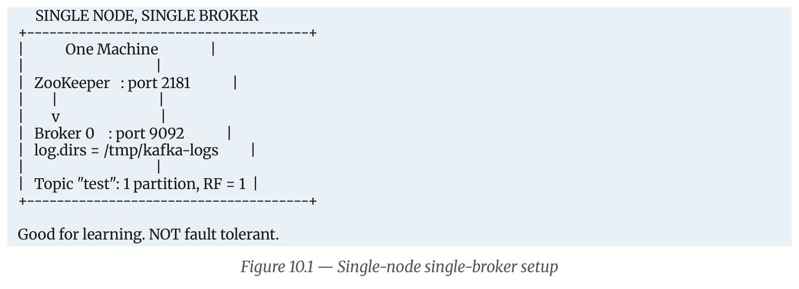

*Figure 13.1: Architecture of a single-node, single-broker development environment.*

---

### 2. Step-by-Step Installation and Startup

#### Step 1: Verify Java Installation
Check that Java is installed and available in the system PATH:
```bash
java -version
```
*(Ensure Java version 8, 11, or 17 is displayed).*

#### Step 2: Download and Extract Apache Kafka
Download the official binary release (.tgz archive) from [kafka.apache.org](https://kafka.apache.org/downloads) and extract it:
```bash
wget https://downloads.apache.org/kafka/3.7.0/kafka_2.13-3.7.0.tgz
tar -xzf kafka_2.13-3.7.0.tgz
cd kafka_2.13-3.7.0
```

#### Step 3: Start ZooKeeper (Terminal 1)
Start the ZooKeeper coordination service using its default configuration file:
* **Linux / macOS:**
  ```bash
  bin/zookeeper-server-start.sh config/zookeeper.properties
  ```
* **Windows (Command Prompt / PowerShell):**
  ```cmd
  bin\windows\zookeeper-server-start.bat config\zookeeper.properties
  ```
*(ZooKeeper starts and binds to port `2181`).*

#### Step 4: Start Kafka Broker (Terminal 2)
In a second terminal window, start the Kafka broker:
* **Linux / macOS:**
  ```bash
  bin/kafka-server-start.sh config/server.properties
  ```
* **Windows (Command Prompt / PowerShell):**
  ```cmd
  bin\windows\kafka-server-start.bat config\server.properties
  ```
Verify that the broker started successfully by checking the console logs for:
```
[KafkaServer id=0] started (kafka.server.KafkaServer)
```
*(The broker is now listening on port `9092`).*

> **Alternative: Modern KRaft Mode (No ZooKeeper):**  
> In modern Kafka releases (3.3+), Kafka can run without ZooKeeper:
> ```bash
> # 1. Generate unique cluster ID
> KAFKA_CLUSTER_ID="$(bin/kafka-storage.sh random-uuid)"
> # 2. Format storage log directory
> bin/kafka-storage.sh format -t $KAFKA_CLUSTER_ID -c config/kraft/server.properties
> # 3. Start broker in KRaft mode
> bin/kafka-server-start.sh config/kraft/server.properties
> ```

---

### 3. Basic Kafka Operations

#### 1. Create a Topic
Create a topic named `orders` with 1 partition and a replication factor of 1:
```bash
bin/kafka-topics.sh --create --topic orders \
    --bootstrap-server localhost:9092 \
    --partitions 1 \
    --replication-factor 1
```
*Expected Console Output:* `Created topic orders.`

#### 2. List Topics
Verify that the topic was created in the cluster:
```bash
bin/kafka-topics.sh --list --bootstrap-server localhost:9092
```
*Expected Output:* `orders`

#### 3. Describe Topic
Inspect the topic's partition, leader, replica, and ISR configuration:
```bash
bin/kafka-topics.sh --describe --topic orders --bootstrap-server localhost:9092
```
*Expected Console Output:*
```
Topic: orders   TopicId: Vz7Q1k...   PartitionCount: 1   ReplicationFactor: 1   Configs: 
  Topic: orders   Partition: 0   Leader: 0   Replicas: 0   Isr: 0
```

#### 4. Produce Messages (Console Producer)
Open an interactive console producer in **Terminal 3**:
```bash
bin/kafka-console-producer.sh --topic orders --bootstrap-server localhost:9092
```
Type messages and press Enter after each line:
```
> {"order_id": 101, "item": "Laptop", "amount": 45000}
> {"order_id": 102, "item": "Keyboard", "amount": 2500}
> {"order_id": 103, "item": "Monitor", "amount": 18000}
```

#### 5. Consume Messages (Console Consumer)
In **Terminal 4**, start a console consumer configured to read all historical messages from the beginning:
```bash
bin/kafka-console-consumer.sh --topic orders \
    --bootstrap-server localhost:9092 \
    --from-beginning
```
*Output displayed in Consumer Terminal:*
```
{"order_id": 101, "item": "Laptop", "amount": 45000}
{"order_id": 102, "item": "Keyboard", "amount": 2500}
{"order_id": 103, "item": "Monitor", "amount": 18000}
```

#### 6. Real-Time Delivery Verification
Type a new message into the Producer terminal. It will appear in the Consumer terminal within milliseconds, demonstrating the publish-subscribe messaging pipeline running on a single-node Kafka setup.

---

### 4. Single-Node Multi-Broker Cluster Setup

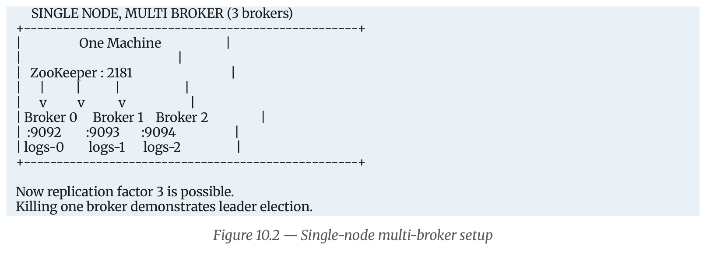

*Figure 13.2: Running 3 Kafka brokers on a single machine with separate ports and log directories.*

To test partition replication (Replication Factor = 3) on a single physical computer:
1. Create separate configuration files: `config/server-1.properties`, `config/server-2.properties`.
2. Configure unique properties:
   * Broker 0: `broker.id=0`, `listeners=PLAINTEXT://:9092`, `log.dirs=/tmp/kafka-logs-0`
   * Broker 1: `broker.id=1`, `listeners=PLAINTEXT://:9093`, `log.dirs=/tmp/kafka-logs-1`
   * Broker 2: `broker.id=2`, `listeners=PLAINTEXT://:9094`, `log.dirs=/tmp/kafka-logs-2`
3. Launch all three brokers in separate terminals.
4. Now create topics with `--partitions 3 --replication-factor 3`. Killing any single broker demonstrates automatic leader election without downtime or data loss.
